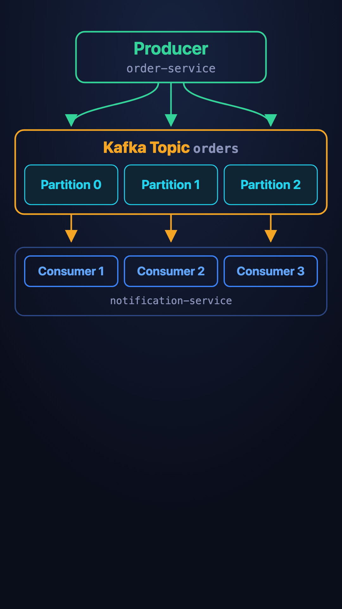
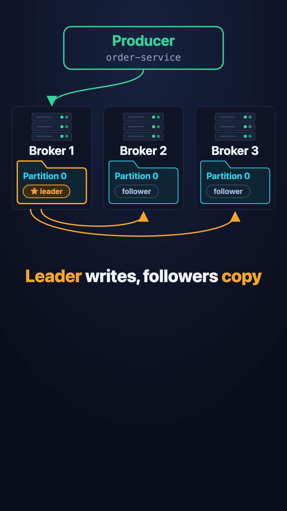
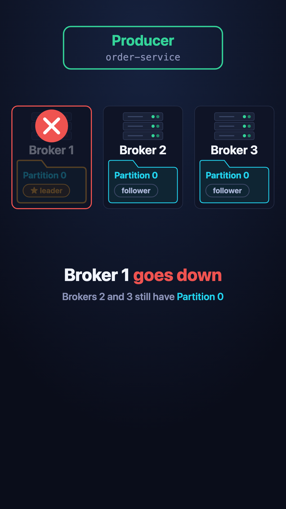
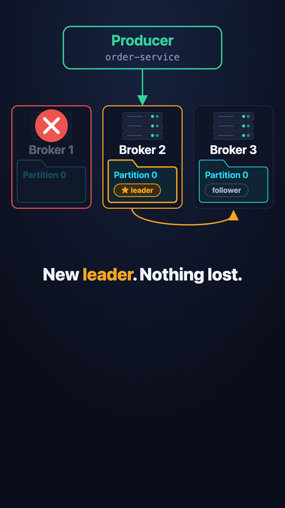
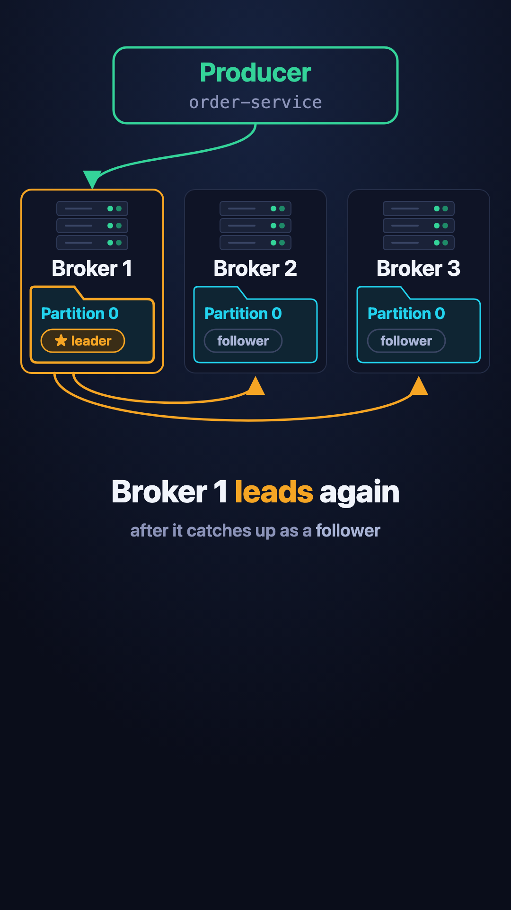
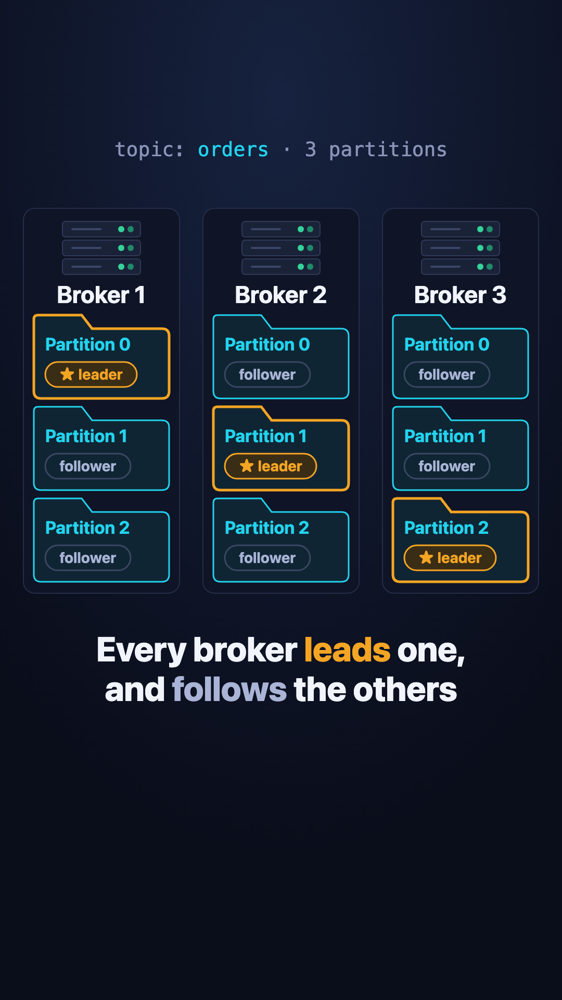

# Kafka Backup

**What happens to your data when a Kafka broker goes down?** Nothing is lost, because Kafka keeps copies on other brokers.

This page goes with the Instagram reel. It walks through the same diagrams, one idea at a time.

## The example

- **order-service** sends order events to Kafka.
- Kafka stores them in a topic called `orders`, split into 3 **partitions**.
- **notification-service** runs 3 instances (consumers). Each one reads one partition.

## 1. Every partition is copied to 3 brokers

A **broker** is a Kafka server. Each broker runs on its own machine.

Partition 0 has a copy on all 3 brokers:

- **Broker 1 is the leader.** New events are written to it.
- **Brokers 2 and 3 are followers.** They copy every new event onto their own disk.

## 2. A broker goes down

Broker 1's machine goes down. Partition 0 has lost its leader, but Brokers 2 and 3 still have a full copy.

## 3. A follower becomes the new leader

Kafka makes one of the followers the new leader. Here it's Broker 2.

- order-service now writes to Broker 2.
- Broker 3 now copies from Broker 2.
- **Nothing is lost**, because Broker 2 already had every event.

## 4. The broker comes back

When Broker 1 is back up:

1. It rejoins as a **follower** and copies the events it missed.
2. Once it has caught up, Kafka makes it the **leader** of Partition 0 again.

## 5. One broker, two roles

Kafka does the same for every partition, and spreads the leaders out:

- Broker 1 leads Partition 0, and follows Partitions 1 and 2.
- Broker 2 leads Partition 1, and follows Partitions 0 and 2.
- Broker 3 leads Partition 2, and follows Partitions 0 and 1.

So a broker can be a **leader and a follower at the same time**, just for different partitions.

## Summary

| Word | Meaning |
|---|---|
| Broker | A Kafka server, on its own machine |
| Leader | The copy of a partition that new events are written to |
| Follower | A copy that keeps itself up to date from the leader |
| Replication factor | How many copies each partition has (3 here) |

## Good to know

- Only followers that are fully caught up can become the new leader. That's why nothing is lost.
- Copies don't protect you from mistakes. If you delete a topic, every copy is deleted too.

## Previous

How Kafka stores your data on disk: [Kafka Storage](../kafka-on-disk).
